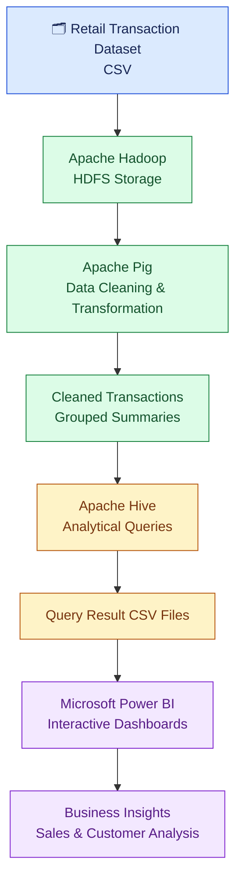
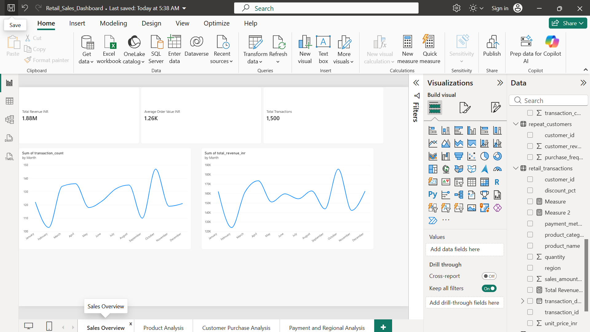
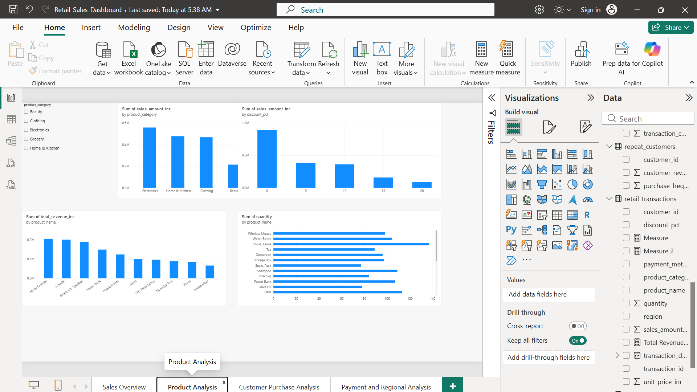
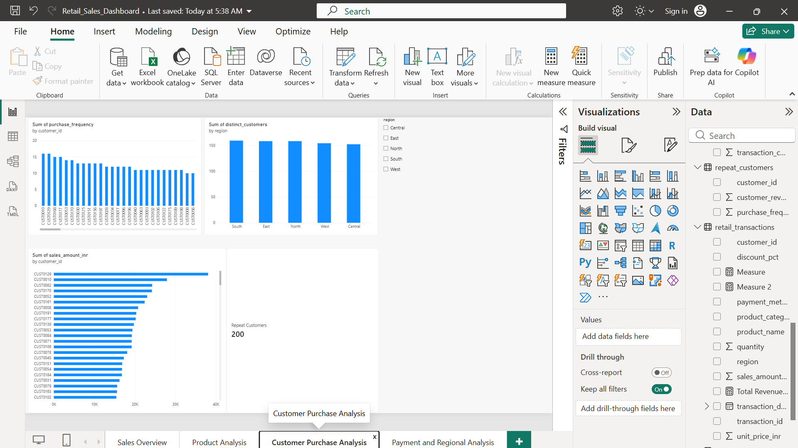
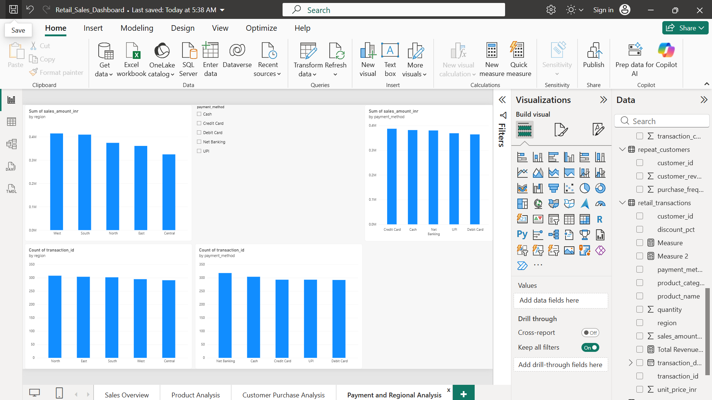

**# 🛍️ Retail Sales and Customer Purchase Pattern Analysis
### Big Data Analytics using Apache Hadoop, Apache Pig, Apache Hive & Microsoft Power BI

<p align="center">
  
  
  
  
  
</p>

<p align="center">
  <b>Transforming retail transactions into meaningful business insights through Big Data technologies.</b>
</p>

---

## 📌 Project Overview

Retail businesses generate large volumes of transactional data every day. Extracting useful information from this data helps organizations understand customer behaviour, product demand, revenue trends and regional performance.

**Retail Big Data Analytics** is a data-processing and visualization project that integrates Apache Hadoop, HDFS, Apache Pig, Apache Hive and Microsoft Power BI to analyze retail transactions.

The project follows a structured workflow:

- **Hadoop & HDFS:** Distributed storage of retail transaction data.
- **Apache Pig:** Data cleaning, transformation and grouping.
- **Apache Hive:** Analytical querying and aggregation.
- **Microsoft Power BI:** Interactive dashboards and business insights.

## 📑 Table of Contents

| No. | Section |
|---|---|
| 1 | [Project Overview](#-project-overview) |
| 2 | [Problem Statement](#-problem-statement) |
| 3 | [Objectives](#-project-objectives) |
| 4 | [Technologies Used](#-technologies-used) |
| 5 | [Dataset Description](#-dataset-description) |
| 6 | [System Architecture](#-system-architecture) |
| 7 | [Project Workflow](#-project-workflow) |
| 8 | [Apache Pig Processing](#-apache-pig--data-processing) |
| 9 | [Apache Hive Analysis](#-apache-hive--analytical-queries) |
| 10 | [Power BI Dashboard](#-power-bi-dashboard) |
| 11 | [Project Results](#-project-results) |
| 12 | [Advantages](#-advantages) |
| 13 | [Future Enhancements](#-future-enhancements) |
| 14 | [Conclusion](#-conclusion) |
| 15 | [Project Structure](#-project-folder-structure) |
| 16 | [Execution Guide](#-execution-and-verification) |

---

## 🎯 Problem Statement

Retail transaction datasets contain information about customers, products, quantities, discounts, payment methods and geographical regions.

Manually processing and analyzing this information can be time-consuming and makes it difficult to discover meaningful patterns.

This project addresses the problem by developing an integrated Big Data analytics workflow that processes retail transactions and generates useful insights into sales performance, customer purchasing behaviour, product performance and regional trends.

## 🚀 Project Objectives

- Process retail transaction data using Hadoop and HDFS.
- Clean the dataset and remove duplicate transactions.
- Filter transactions based on sales amount.
- Group transactions by customer and product category.
- Perform analytical queries using Apache Hive.
- Identify high-revenue categories and best-selling products.
- Analyze monthly sales and customer purchase patterns.
- Examine payment preferences and regional performance.
- Develop interactive Power BI dashboards for business analysis.

## 🛠️ Technologies Used

| Technology | Purpose |
|---|---|
| Apache Hadoop | Distributed storage and processing infrastructure |
| HDFS | Stores input and processed datasets |
| Apache Pig | Data cleaning and transformation |
| Pig Latin | Defines data-processing operations |
| Apache Hive | Analytical querying and aggregation |
| HiveQL | SQL-like data analysis |
| Microsoft Power BI | Interactive data visualization |
| Python | Automates query-result exports and validation |
| CSV | Stores input data and analytical outputs |
| Java | Supports the Hadoop ecosystem |
| Visual Studio Code | Development and project management |

## 📊 Dataset Description

The project uses a retail transaction dataset in CSV format containing **1,500 transaction records**.

### Dataset attributes

| Column | Description |
|---|---|
| `transaction_id` | Unique transaction identifier |
| `transaction_date` | Date of the transaction |
| `customer_id` | Customer identifier |
| `region` | Geographical region |
| `product_category` | Purchased product category |
| `product_name` | Product name |
| `quantity` | Quantity purchased |
| `unit_price_inr` | Unit price in Indian rupees |
| `discount_pct` | Discount percentage |
| `sales_amount_inr` | Transaction sales amount |
| `payment_method` | Payment method used |

The dataset is inspected to examine its schema, data types, missing values, duplicates and numeric ranges before processing.

## 🏗️ System Architecture

The project follows a sequential Big Data processing and analytics architecture.



## 🔄 Project Workflow

<details>
<summary><b>Step 1 — Dataset Preparation</b></summary>

The retail transaction CSV dataset is inspected and prepared for processing. Its column structure, data types, missing values and duplicate records are examined.

</details>

<details>
<summary><b>Step 2 — HDFS Storage</b></summary>

The input dataset is uploaded to Hadoop Distributed File System (HDFS). Separate directories are maintained for input, cleaned data, grouped data and analytical outputs.

</details>

<details>
<summary><b>Step 3 — Apache Pig Processing</b></summary>

Apache Pig processes the input dataset using Pig Latin.

The processing operations include:

1. Loading the CSV dataset.
2. Handling the header row.
3. Converting fields to appropriate data types.
4. Removing duplicate transactions according to the selected deduplication rule.
5. Filtering invalid or non-positive sales amounts.
6. Grouping transactions by customer and product category.
7. Calculating transaction counts, total quantities and total sales.
8. Storing cleaned transactions and grouped summaries in HDFS.

</details>

<details>
<summary><b>Step 4 — Apache Hive Analysis</b></summary>

Apache Hive creates the `retail_db` database and the `retail_transactions` external table over the cleaned transaction data.

HiveQL queries analyze revenue, monthly sales, customer purchase values, best-selling products, payment methods, discounts and regional performance.

</details>

<details>
<summary><b>Step 5 — Power BI Visualization</b></summary>

The verified transaction data and exported Hive query results are imported into Microsoft Power BI.

Four dashboard pages present sales, product, customer, payment and regional insights.

</details>

<details>
<summary><b>Step 6 — Validation</b></summary>

The output files, Hive tables, analytical query results and Power BI figures are checked for consistency. Dashboard screenshots are collected as execution evidence.

</details>

## 🐘 Apache Pig — Data Processing

Apache Pig is used to clean, transform and group retail transaction data.

| Pig Operation | Function |
|---|---|
| `LOAD` | Reads the transaction dataset |
| `FILTER` | Selects records satisfying the filtering condition |
| `DISTINCT` | Removes identical complete records |
| `FOREACH ... GENERATE` | Transforms and selects fields |
| `GROUP` | Groups transactions by customer and product category |
| `COUNT` | Calculates record counts |
| `SUM` | Calculates total sales and quantity |
| `STORE` | Saves processed data to HDFS |

The cleaned transaction dataset is stored separately from the grouped customer-category summaries.

**Implementation:** [`pig/retail_cleaning.pig`](pig/retail_cleaning.pig)

## 🐝 Apache Hive — Analytical Queries

Apache Hive provides a SQL-like interface for querying processed retail data.

**Database:** `retail_db`  
**Primary table:** `retail_transactions`

### Key analytical queries

| Analysis | Objective |
|---|---|
| Revenue by Product Category | Identify the highest-revenue categories |
| Monthly Sales Analysis | Examine monthly revenue trends |
| Top 10 Customers | Rank customers by purchase value |
| Best-Selling Products | Identify products with the highest quantity sold |
| Payment Method Analysis | Compare payment transaction counts and revenue |

### Additional analyses

- Overall sales KPIs
- Discount analysis
- Customer purchase frequency
- Repeat customer analysis
- Category-wise quantity sold
- Region-wise revenue
- Regional distribution
- Top products by revenue

**SQL implementation:**

- [`create_database.sql`](hive/create_database.sql)
- [`create_table.sql`](hive/create_table.sql)
- [`analysis_queries.sql`](hive/analysis_queries.sql)

**Export and validation:** [`export_results.py`](hive/export_results.py)

## 📈 Power BI Dashboard

The Power BI report contains four interactive dashboard pages designed to present retail business performance.

### 1. Sales Overview



- Total revenue
- Total transactions
- Average transaction value
- Monthly sales trend
- Transaction volume

### 2. Product Analysis



- Category-wise revenue
- Top-selling products
- Quantity sold
- Discount analysis

### 3. Customer Purchase Analysis



- Customer-wise revenue
- Purchase frequency
- Repeat customers
- Regional distribution

### 4. Payment and Regional Analysis



- Payment method distribution
- Revenue by payment method
- Region-wise revenue
- Region-wise transaction volume

The dashboard combines KPI cards, charts and slicers to support interactive exploration and comparison.

**Power BI report:** [`Retail_Sales_Dashboard.pbix`](powerbi/Retail_Sales_Dashboard.pbix)

## 📌 Project Results

### Verified dashboard metrics

| Metric | Result |
|---|---:|
| Total Revenue | ₹18,83,001.20 |
| Total Transactions | 1,500 |
| Total Customers | 200 |
| Quantity Sold | 2,573 |
| Average Transaction Value | ₹1,255.33 |
| Average Discount | 5.46% |
| Highest Monthly Sales | ₹1,85,792.10 |
| Highest Sales Month | October 2025 |

### Revenue by product category

| Product Category | Revenue |
|---|---:|
| Electronics | ₹5,58,716.60 |
| Home & Kitchen | ₹4,78,227.90 |
| Clothing | ₹4,68,489.05 |
| Beauty | ₹2,14,562.85 |
| Grocery | ₹1,63,004.80 |

### Revenue by region

| Region | Revenue |
|---|---:|
| West | ₹4,14,297.05 |
| South | ₹4,09,256.90 |
| North | ₹3,74,014.65 |
| East | ₹3,60,850.90 |
| Central | ₹3,24,581.70 |

The results demonstrate how the processed retail data can be used to understand sales performance, product demand and regional contributions.

## ⭐ Advantages

- Organizes the retail data-processing workflow.
- Reduces manual data cleaning and aggregation.
- Supports analysis of customer and product performance.
- Enables monthly, regional and payment-related comparisons.
- Provides visual summaries for business decision-making.
- Demonstrates the integration of Hadoop, Pig, Hive and Power BI.

## 🔮 Future Enhancements

- Process larger retail datasets.
- Automate scheduled data ingestion and reporting.
- Introduce advanced customer segmentation.
- Develop sales forecasting models.
- Analyze product recommendations and customer buying patterns.
- Integrate automated alerts for unusual sales changes.

## 🏁 Conclusion

This project demonstrates an integrated Big Data analytics workflow for retail transaction analysis.

Apache Hadoop and HDFS provide the storage infrastructure, Apache Pig performs data cleaning and transformation, and Apache Hive enables analytical querying. Microsoft Power BI presents the resulting information through interactive dashboards.

The integrated workflow transforms raw retail transactions into meaningful insights about sales performance, product demand, customer behaviour, payment preferences and regional trends.

## 📁 Project Folder Structure

```text
Retail_BigData_Analytics/
│
├── dataset/
│   └── retail_transactions.csv
│
├── pig/
│   └── retail_cleaning.pig
│
├── hive/
│   ├── create_database.sql
│   ├── create_table.sql
│   ├── analysis_queries.sql
│   ├── export_results.py
│   └── output/
│       ├── best_selling_products.csv
│       ├── category_sales.csv
│       ├── customer_purchase_frequency.csv
│       ├── discount_analysis.csv
│       ├── monthly_sales.csv
│       ├── overall_sales_kpis.csv
│       ├── payment_method_analysis.csv
│       ├── payment_preferences.csv
│       ├── quantity_sold_by_product.csv
│       ├── region_wise_revenue.csv
│       ├── regional_distribution.csv
│       ├── repeat_customers.csv
│       ├── revenue_by_category.csv
│       ├── top_10_customers.csv
│       └── top_products_by_revenue.csv
│
├── powerbi/
│   ├── Measures.dax
│   ├── RetailTransactions.pq
│   ├── Retail_Sales_Dashboard.pbix
│   └── retail_transactions.csv
│
├── report/
│   ├── Retail_Sales_Dashboard.pdf
│   └── screenshots/
│       ├── 01_sales_overview.png
│       ├── 02_product_analysis.png
│       ├── 03_customer_purchase_analysis.png
│       └── 04_payment_and_regional_analysis.png
│
├── .gitignore
└── README.md
```

## ▶️ Execution and Verification

Follow the steps below to execute the complete project.

1. Verify the input retail transaction dataset.
2. Upload the dataset to HDFS.
3. Execute the Apache Pig processing script.
4. Verify cleaned and grouped HDFS outputs.
5. Create the Hive database and transaction table.
6. Execute the required Hive analytical queries.
7. Export and validate the 15 query-result CSV files.
8. Import the required data into Power BI.
9. Complete and validate all four dashboard pages.
10. Save dashboard screenshots and document the verified findings.

---

<p align="center">
  <b>Retail Big Data Analytics</b><br/>
  Turning Retail Data into Business Insights
</p>

<p align="center">
  ⭐ If you find this project interesting, consider giving the repository a star!
</p>

<p align="center">
  <a href="https://github.com/meghanagowda75/Retail_BigData_Analytics">View Repository on GitHub</a>
</p>
**
